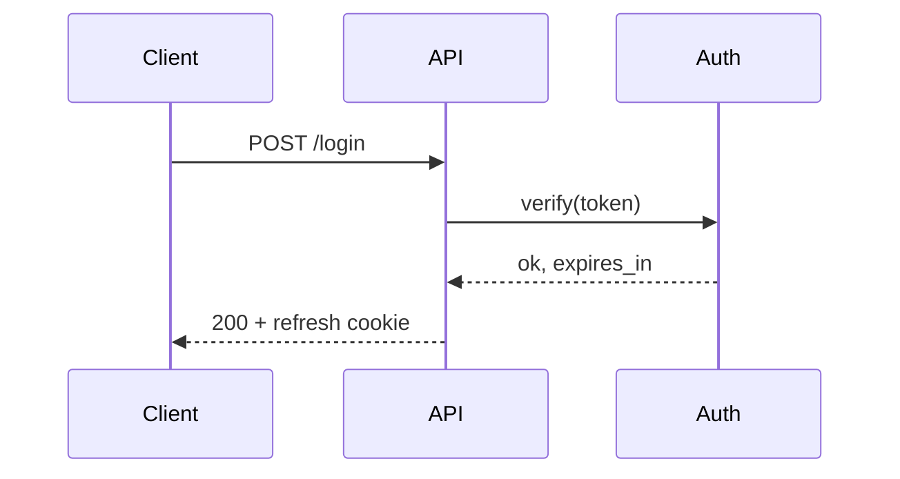

# GitHub formatting for PR descriptions

GitHub renders PR bodies, comments and issues as GitHub Flavored Markdown plus a set of
extensions. This file lists the ones that make a PR faster to review, with the syntax.
Source: GitHub Docs, "Working with advanced formatting" and "Basic writing and formatting
syntax" (https://docs.github.com/en/get-started/writing-on-github). Check the page when a
limit matters, because GitHub changes them.

## Contents

1. Collapsed sections
2. Alerts
3. Tables
4. Code blocks, diffs and suggestions
5. Diagrams
6. Images, light and dark variants, sizing
7. Attaching files
8. Autolinked references and mentions
9. Linking issues with keywords
10. Permalinks to code
11. Task lists
12. Footnotes, math, keyboard keys and comments
13. Checking how it renders

## 1. Collapsed sections

Hide long material so the first screen stays short. Leave a blank line after `<summary>`
so Markdown inside renders.

```markdown
<details>
<summary>Full test output (312 passed)</summary>

```text
...
```

</details>
```

Add `open` (`<details open>`) to start expanded. Use for: logs, benchmark tables,
background, alternatives considered, long file lists, recordings.

## 2. Alerts

Five types, each on its own blockquote. Use at most one or two per PR, for facts that
change what a reviewer or deployer does.

```markdown
> [!NOTE]
> Behaviour is unchanged for existing users; the flag defaults to off.

> [!TIP]
> Review commit by commit; each one builds and passes tests.

> [!IMPORTANT]
> Run the migration before deploying the API.

> [!WARNING]
> This drops the `legacy_tokens` table.

> [!CAUTION]
> Rolling back after the migration loses rows written since deploy.
```

## 3. Tables

Use for before and after, option comparisons, and metrics. `:---:` centres a column,
`---:` right-aligns numbers. Escape a pipe inside a cell as `\|`.

```markdown
| Metric | Before | After |
| --- | ---: | ---: |
| p95 latency, `/search` | 820 ms | 310 ms |
| Bundle size | 412 KB | 388 KB |
```

## 4. Code blocks, diffs and suggestions

- Fence with three backticks and a language for highlighting: `bash`, `python`, `ts`, `json`, `yaml`, `text`.
- Use four backticks around a block that itself contains three.
- A `diff` block shows a config or API change inline:

````markdown
```diff
- timeout: 30
+ timeout: 5
```
````

- In a review comment on a diff line, a `suggestion` block gives the author a one-click
  "Commit suggestion" button. It works only in review comments, never in the PR body:

````markdown
```suggestion
    return items[:limit]
```
````

## 5. Diagrams

Fenced `mermaid` blocks render as diagrams: flowchart, sequence, state, class, ER, Gantt.
Use one when a flow or architecture change is hard to read from the diff.

````markdown

````

GitHub also renders `geojson`, `topojson` and `stl` blocks as maps and 3D models, and
`math` blocks as LaTeX.

## 6. Images, light and dark variants, sizing

- Markdown image: ``. The alt text is read by screen
  readers and shown when the image fails, so describe what it shows.
- HTML when you need a size: ``. Set only `width`
  so the aspect ratio holds.
- Side by side: put two images in a table (see the template).
- Light and dark screenshots of a themed UI:

```html
<picture>
  <source media="(prefers-color-scheme: dark)" srcset="dark.png">
  
</picture>
```

- Relative paths do not work in PR bodies. Use an uploaded attachment URL or a full URL.

## 7. Attaching files

In the GitHub web editor, drag and drop, paste, or click the attach bar under the comment
box. GitHub uploads the file and inserts a link: an image shows inline, a video shows as a
player, other files show as download links.

As of the GitHub Docs page "Attaching files" (check it for current limits):
- Images and GIFs: up to 10 MB.
- Videos (`.mp4`, `.mov`, `.webm`): up to 10 MB on free plans, up to 100 MB on paid plans.
- Other files: up to 25 MB. Supported types include `.png`, `.gif`, `.jpg`, `.svg`, `.pdf`,
  `.txt`, `.log`, `.md`, `.csv`, `.json`, `.zip`, `.gz`, `.tgz`, `.patch`, `.docx`,
  `.pptx`, `.xlsx`.
- Uploads in a private repo are visible only to people with access to that repo.

GitHub has no public API for these uploads, so an agent cannot attach a file through `gh`
or the REST API. See `media.md` for the two working routes.

## 8. Autolinked references and mentions

GitHub turns these into links in PR bodies and comments:

| Write | Links to |
| --- | --- |
| `#123` or `GH-123` | Issue or PR 123 in this repo |
| `owner/repo#123` | Issue or PR in another repo |
| `a5c3785` (7+ hex chars) | A commit in this repo |
| `owner/repo@a5c3785` | A commit in another repo |
| `@user`, `@org/team` | Mentions; each sends a notification |
| A full URL to an issue, PR or commit | A short reference such as `owner/repo#123` |

Wrap a reference in backticks to stop the link and the notification: `` `@here` ``.
Repos can add custom autolinks (for example `JIRA-123`) in their settings.

## 9. Linking issues with keywords

In the PR body, a keyword before an issue reference links the issue and closes it when the
PR merges into the repo's default branch. Into any other branch, nothing closes.

- Keywords: `close`, `closes`, `closed`, `fix`, `fixes`, `fixed`, `resolve`, `resolves`, `resolved`.
- Same repo: `Closes #10`. Other repo: `Fixes owner/repo#10`.
- One keyword per issue: `Closes #10, closes #11`.
- `Refs #10` or "Part of #10" links without closing.
- Keywords in commit messages also close issues when the commit lands on the default branch.

## 10. Permalinks to code

Link to code at a commit, so the link keeps pointing at the same lines after the file
changes. On GitHub, open the file, press `y` to switch the URL to the commit SHA, click a
line number, shift-click a second one, and copy the URL:

```text
https://github.com/owner/repo/blob/3f9a1c2/src/auth/session.py#L40-L58
```

Pasted on its own line in a PR body or comment, a permalink to the same repo renders as a
code snippet. Use it under "How to review" to point at the lines that matter.

## 11. Task lists

`- [ ]` and `- [x]` render as checkboxes that people with write access can tick in the
browser. GitHub shows "3 of 7 tasks" on the PR in lists. Use them for the checklist and for
follow-ups that block merge. A task item that is an issue reference (`- [ ] #45`) shows
the issue's title and state.

## 12. Footnotes, math, keyboard keys and comments

- Footnotes: `Latency fell 60%[^1].` with `[^1]: Measured on staging, 3 runs, median.` at
  the end. Keeps evidence out of the main text.
- Math: `$O(n \log n)$` inline, or a `$$ ... $$` block.
- Keys: `<kbd>Ctrl</kbd>+<kbd>K</kbd>`.
- Small text: `<sub>Generated by ...</sub>`.
- HTML comments `<!-- ... -->` do not render. Use them for template hints; delete
  them before opening the PR so the raw body stays clean.
- A line break inside a paragraph needs a trailing backslash or `<br>`, or a blank line
  for a new paragraph.

## 13. Checking how it renders

- In the browser: the **Preview** tab of the PR editor.
- From a terminal, render the body through GitHub's Markdown API with the repo as context,
  so `#123` links resolve:

```bash
gh api markdown -f mode=gfm -f context=owner/repo -F text=@pr-body.md > preview.html
```

- After opening: `gh pr view --web` and read the first screen as the reviewer would.
